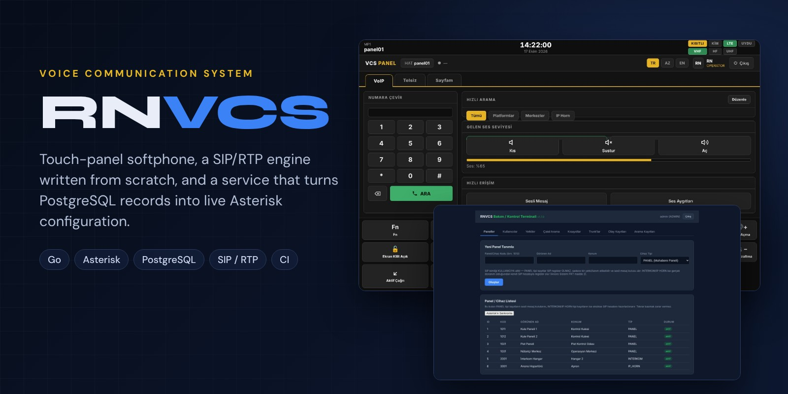
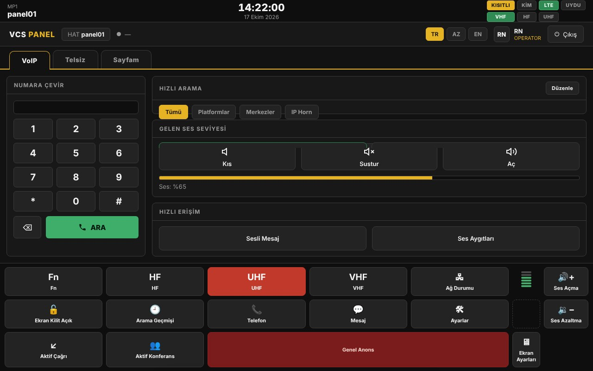
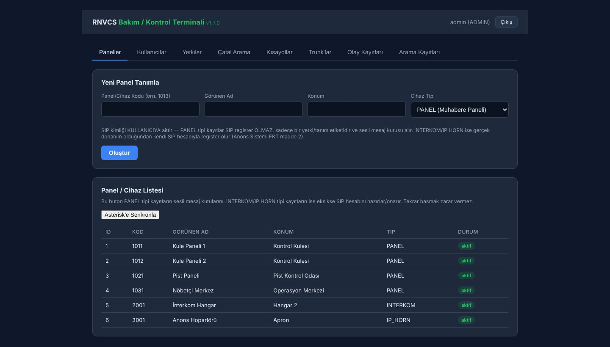
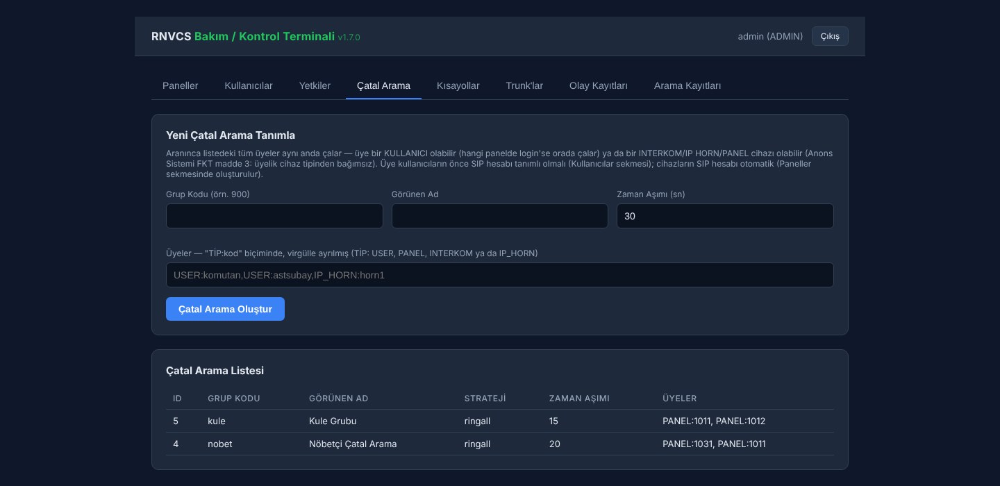
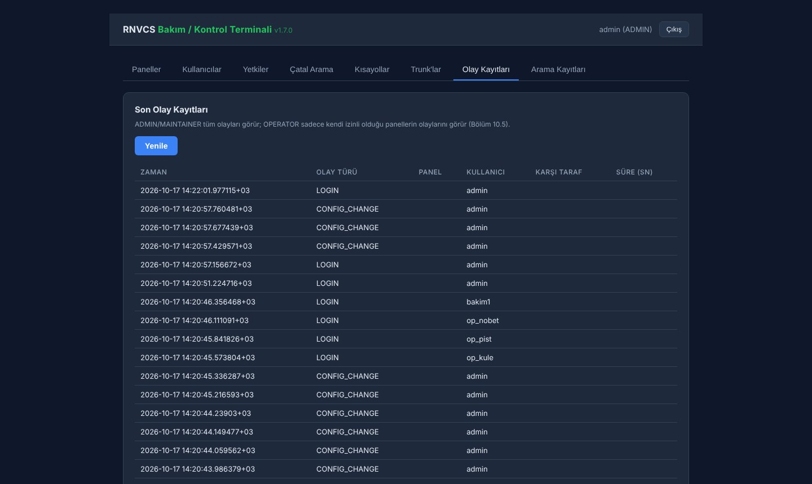
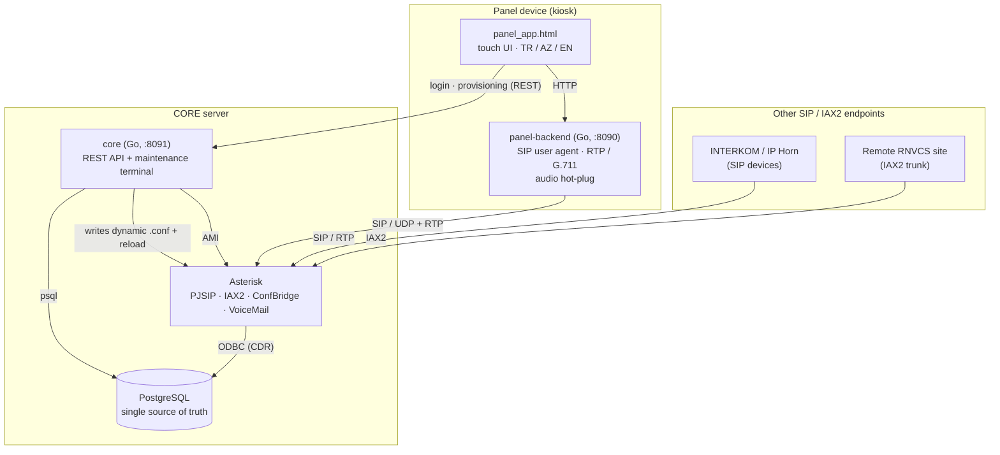

<p align="center">
  
</p>

<p align="center">
  <b>English</b> · <a href="README.tr.md">Türkçe</a>
</p>

<p align="center">
  <a href="https://github.com/ErenOzgu/Dev-Ops/actions/workflows/ci.yml"></a>
  
  
  
  
</p>

<p align="center">
  A voice communication system for control rooms and operations centres, built on <b>Asterisk</b>.<br>
  Touch-panel softphones place calls, ring groups, conferences and voicemail through a central server;
  administrators manage everything from a web terminal. The <b>Go</b> services have <b>zero third-party dependencies</b>.
</p>

<p align="center">
  <a href="#what-it-does">What it does</a> ·
  <a href="#architecture">Architecture</a> ·
  <a href="#design-decisions">Design decisions</a> ·
  <a href="#try-it-locally">Try it locally</a> ·
  <a href="#tests-and-ci">Tests and CI</a> ·
  <a href="#release-and-deployment">Release and deployment</a>
</p>

---

## What it does

- **Panel softphone.** A kiosk touch UI (`panel-app`) backed by a local Go service (`panel-backend`) that implements a SIP user agent and an RTP/G.711 audio bridge, and watches audio devices (USB headsets, tactical microphones) as they are plugged in and out.
- **Central management.** `core` is a REST API plus an embedded maintenance terminal. Panels, users, per-panel permissions, ring groups, speed dials and IAX2 trunks live in PostgreSQL; creating one writes the matching Asterisk configuration and reloads it.
- **Calls, conferences, voicemail.** Direct calls, ring groups, ConfBridge conferences (started over AMI), voicemail playback from the panel, and call detail records joined with who was logged in at which panel.
- **Roles.** `ADMIN`, `MAINTAINER` and `OPERATOR`, with per-user, per-panel permissions. The panel UI is available in Turkish, Azerbaijani and English.
- **Operations tooling.** Install, migrate, deploy, roll back, back up and smoke-test scripts, systemd units, and a Gitea CI/CD pipeline with a canary stage.

<table>
  <tr>
    <td width="50%"></td>
    <td width="50%"></td>
  </tr>
  <tr>
    <td align="center"><sub>Panel app (kiosk touch UI, runs in demo mode without a backend)</sub></td>
    <td align="center"><sub>Maintenance terminal: panels and devices</sub></td>
  </tr>
  <tr>
    <td width="50%"></td>
    <td width="50%"></td>
  </tr>
  <tr>
    <td align="center"><sub>Ring groups</sub></td>
    <td align="center"><sub>Audit event log</sub></td>
  </tr>
</table>

<sub>Screenshots use fictional demo data.</sub>

## Architecture



| Component | Runs on | What it is |
|---|---|---|
| [`RNVCS/core`](RNVCS/core) | CORE server | Go REST API and embedded maintenance terminal (`:8091`). Authentication and sessions, user/panel/permission management, config writers for PJSIP, dialplan, IAX2, ConfBridge and voicemail, an AMI client, and a conference watcher. |
| [`RNVCS/panel-backend`](RNVCS/panel-backend) | each panel device | Go service (`:8090`) with a SIP user agent (REGISTER, INVITE, BYE), an RTP/G.711 bridge, volume control and audio-device discovery through PipeWire. |
| [`RNVCS/panel-app`](RNVCS/panel-app) | panel kiosk browser | Single-file HTML/JS operator UI: login, dialpad, speed dial, incoming and active call screens, conference, voicemail. |
| [`RNVCS/migrations`](RNVCS/migrations) | PostgreSQL | Idempotent schema migrations. |
| [`RNVCS/scripts`](RNVCS/scripts) | servers | Install, migrate, deploy, rollback, backup and smoke-test scripts, plus the integration test used in CI. |
| [`RNVCS/infra/systemd`](RNVCS/infra/systemd) | servers | Unit files for the services. |
| [`RNVCS/.gitea/workflows`](RNVCS/.gitea/workflows) | CI server | The project's own Gitea CI/CD pipeline. |

## Design decisions

- **PostgreSQL is the single source of truth.** A panel, user or trunk is written to the database first; the matching block is then generated into an Asterisk dynamic config file and Asterisk is reloaded. Asterisk realtime is deliberately not used. If Asterisk is unavailable, a panel record is still created and the API returns a warning that `/api/panels/sync` can repair later; ring groups and trunks are rolled back when their configuration cannot be written.
- **Zero third-party Go dependencies.** Built for an isolated network where the Go module proxy is not guaranteed. Everything is standard library: password hashing (PBKDF2-HMAC-SHA256, 210,000 iterations), the AMI client, the SIP message handling, RTP and the G.711 codec. The database is reached through the `psql` CLI.
- **SIP identity belongs to the operator, not the device.** Whoever logs in at a panel registers with their own SIP account, so the call records show a person rather than a seat. Hardware such as INTERKOM and IP Horn units gets its own endpoint.
- **Safe-by-design delivery.** Releases are tagged builds that deploy automatically only as far as a standby CORE, followed by a smoke test. Production is a separate manually triggered workflow that takes a pre-deploy database backup first, and `rollback.sh` returns to the previous release. See [`CICD_TASARIMI.md`](RNVCS/docs/CICD_TASARIMI.md).
- **Migrations are idempotent and tested twice.** CI applies every migration two times against a real PostgreSQL and fails if the second run errors.

## Try it locally

You need Go 1.21+, PostgreSQL (CI uses 16) with the `psql` client, and `curl`. Asterisk is **not** required to explore the API and the maintenance terminal.

```bash
# 1) Database
createdb rnvcs
for f in RNVCS/migrations/*.sql; do psql -v ON_ERROR_STOP=1 rnvcs -f "$f"; done

# 2) Core service
cd RNVCS/core
export RNVCS_DB_DSN='postgresql://localhost/rnvcs?sslmode=disable'
export RNVCS_PROVISIONING_KEY='dev-only-key'
go run . create-admin admin 'choose-a-password'
go run .                       # listens on :8091
```

Open <http://localhost:8091> for the maintenance terminal and sign in as the admin you just created.

For the panel UI, open `RNVCS/panel-app/panel_app_3_1.html?demo` in a browser. Demo mode needs no backend. To point it at a live core, use `?core=http://localhost:8091&panel=<panel_code>`.

Without Asterisk, creating panels and users still works and returns a warning; ring groups, IAX2 trunks and conferences need Asterisk because they write its configuration and call its CLI/AMI.

## Tests and CI

```bash
# unit tests (both Go modules)
(cd RNVCS/core && go test ./... -race)
(cd RNVCS/panel-backend && go test ./... -race)

# end-to-end against a real PostgreSQL (22 checks: migrations twice, login, user/panel/permission flow, logout)
RNVCS_DB_DSN='postgresql://localhost/rnvcs_test?sslmode=disable' ./RNVCS/scripts/ci_integration_test.sh
```

GitHub Actions ([`ci.yml`](.github/workflows/ci.yml)) runs on every push and pull request: `gofmt`, `go vet` and race-enabled tests for both modules, `bash -n` over every shell script, and the integration test above against a PostgreSQL service container.

## Release and deployment

| Step | What happens |
|---|---|
| Push / PR | Lint, unit tests and migration test (Gitea CI, [`ci.yml`](RNVCS/.gitea/workflows/ci.yml)) |
| Tag `vX.Y.Z` | Build and package, deploy to the **standby CORE** (canary), run the smoke test; stops on failure ([`release.yml`](RNVCS/.gitea/workflows/release.yml)) |
| Production | Never automatic: a separate, manually triggered workflow with explicit confirmation and a database backup first ([`deploy-production.yml`](RNVCS/.gitea/workflows/deploy-production.yml)) |
| Problem | `scripts/rollback.sh` returns to the previous release |

Server provisioning is in [`scripts/core_kurulum.sh`](RNVCS/scripts/core_kurulum.sh) (Asterisk, PostgreSQL, ODBC, database and role, PJSIP transports) and [`scripts/install_yonetim_servisi.sh`](RNVCS/scripts/install_yonetim_servisi.sh) (core service, AMI user, environment file).

## Repository layout

```text
.
├── .github/workflows/ci.yml      # GitHub Actions: Go, shell syntax, PostgreSQL integration test
├── docs/                         # README images
└── RNVCS/
    ├── core/                     # management service (REST API, config writers, AMI client)
    │   ├── internal/{api,auth,pg,pjsip,dialplan,confbridge,iaxconf,voicemail,ami,confwatch}
    │   └── web/                  # embedded maintenance terminal
    ├── panel-backend/            # panel-side SIP/RTP engine and audio watcher
    ├── panel-app/                # kiosk touch UI
    ├── migrations/               # PostgreSQL schema
    ├── scripts/                  # install, deploy, rollback, backup, smoke and integration tests
    ├── infra/systemd/            # unit files
    ├── .gitea/workflows/         # project CI/CD
    └── docs/                     # architecture, API reference, CI/CD design, test plan, roadmap
```

## Documentation

The in-depth documents are written in Turkish, the working language of the project.

| Document | Contents |
|---|---|
| [`MIMARI.md`](RNVCS/docs/MIMARI.md) | Architecture and how a request flows through the system, package by package |
| [`API_REFERANSI.md`](RNVCS/docs/API_REFERANSI.md) | Every REST endpoint with roles and payloads |
| [`CICD_TASARIMI.md`](RNVCS/docs/CICD_TASARIMI.md) | CI/CD design and the reasoning behind the automation levels |
| [`vcs_test_plan.md`](RNVCS/docs/vcs_test_plan.md) | Test plan |
| [`rnvcs_yazilim_yol_haritasi.md`](RNVCS/docs/rnvcs_yazilim_yol_haritasi.md) | Roadmap and gap analysis |
| [`CHANGELOG.md`](RNVCS/docs/CHANGELOG.md) | Change log |

## Scope and status

RNVCS is designed for an isolated, trusted operations network. It is **not hardened for exposure to the internet**: HTTP, SIP and RTP are unencrypted and sessions are held in memory. Example addresses in the documentation use the reserved ranges `192.0.2.0/24` and `198.51.100.0/24`.
