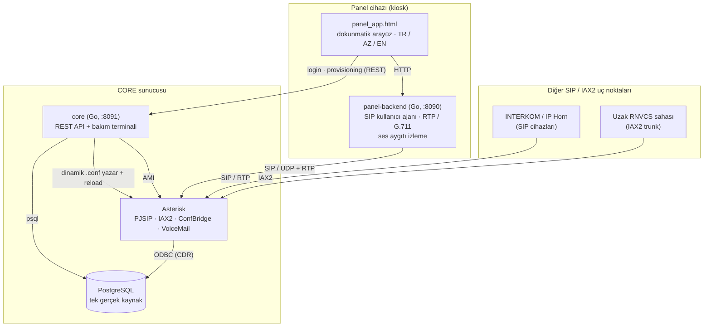

<p align="center">
  
</p>

<p align="center">
  <a href="README.md">English</a> · <b>Türkçe</b>
</p>

<p align="center">
  <a href="https://github.com/ErenOzgu/Dev-Ops/actions/workflows/ci.yml"></a>
  
  
  
  
</p>

<p align="center">
  Kontrol odaları ve operasyon merkezleri için <b>Asterisk</b> tabanlı bir sesli haberleşme sistemi.<br>
  Dokunmatik panel yazılımları aramaları, çatal aramaları, konferansları ve sesli mesajları merkezi bir sunucu üzerinden yürütür;
  yöneticiler her şeyi bir web terminalinden yönetir. <b>Go</b> servislerinin <b>hiçbir üçüncü taraf bağımlılığı yoktur</b>.
</p>

<p align="center">
  <a href="#ne-yapar">Ne yapar</a> ·
  <a href="#mimari">Mimari</a> ·
  <a href="#tasarım-kararları">Tasarım kararları</a> ·
  <a href="#yerelde-deneyin">Yerelde deneyin</a> ·
  <a href="#testler-ve-ci">Testler ve CI</a> ·
  <a href="#sürüm-ve-dağıtım">Sürüm ve dağıtım</a>
</p>

---

## Ne yapar

- **Panel yazılımı.** Dokunmatik kiosk arayüzü (`panel-app`) ve arkasında bir SIP kullanıcı ajanı ile RTP/G.711 ses köprüsü uygulayan, ayrıca ses aygıtlarını (USB kulaklık, taktik mikrofon) takılıp çıkarıldıkça izleyen yerel bir Go servisi (`panel-backend`).
- **Merkezi yönetim.** `core`, bir REST API ve gömülü bakım terminalidir. Paneller, kullanıcılar, panel bazlı yetkiler, çatal aramalar, hızlı arama kısayolları ve IAX2 trunk'lar PostgreSQL'de durur; biri oluşturulduğunda ilgili Asterisk yapılandırması yazılır ve yeniden yüklenir.
- **Arama, konferans, sesli mesaj.** Doğrudan arama, çatal arama, ConfBridge konferansları (AMI üzerinden başlatılır), panelden sesli mesaj dinleme ve hangi panelde kimin oturum açtığıyla birleştirilmiş arama kayıtları.
- **Roller.** `ADMIN`, `MAINTAINER` ve `OPERATOR`; kullanıcı ve panel bazlı yetkilerle. Panel arayüzü Türkçe, Azerbaycan Türkçesi ve İngilizce kullanılabilir.
- **Operasyon araçları.** Kurulum, migration, dağıtım, geri alma, yedekleme ve smoke test betikleri, systemd birimleri ve canary aşamalı bir Gitea CI/CD hattı.

<table>
  <tr>
    <td width="50%"></td>
    <td width="50%"></td>
  </tr>
  <tr>
    <td align="center"><sub>Panel uygulaması (kiosk dokunmatik arayüz; arka uç olmadan demo modunda çalışır)</sub></td>
    <td align="center"><sub>Bakım terminali: paneller ve cihazlar</sub></td>
  </tr>
  <tr>
    <td width="50%"></td>
    <td width="50%"></td>
  </tr>
  <tr>
    <td align="center"><sub>Çatal arama grupları</sub></td>
    <td align="center"><sub>Olay (denetim) kayıtları</sub></td>
  </tr>
</table>

<sub>Ekran görüntüleri kurgusal demo verisi kullanır.</sub>

## Mimari



| Bileşen | Nerede çalışır | Nedir |
|---|---|---|
| [`RNVCS/core`](RNVCS/core) | CORE sunucusu | Go REST API ve gömülü bakım terminali (`:8091`). Kimlik doğrulama ve oturumlar, kullanıcı/panel/yetki yönetimi, PJSIP, dialplan, IAX2, ConfBridge ve voicemail için yapılandırma yazıcıları, AMI istemcisi ve konferans izleyicisi. |
| [`RNVCS/panel-backend`](RNVCS/panel-backend) | her panel cihazı | SIP kullanıcı ajanı (REGISTER, INVITE, BYE), RTP/G.711 köprüsü, ses seviyesi kontrolü ve PipeWire üzerinden ses aygıtı keşfi olan Go servisi (`:8090`). |
| [`RNVCS/panel-app`](RNVCS/panel-app) | panel kiosk tarayıcısı | Tek dosyalık HTML/JS operatör arayüzü: giriş, tuş takımı, hızlı arama, gelen ve aktif çağrı ekranları, konferans, sesli mesaj. |
| [`RNVCS/migrations`](RNVCS/migrations) | PostgreSQL | Idempotent şema migration'ları. |
| [`RNVCS/scripts`](RNVCS/scripts) | sunucular | Kurulum, migration, dağıtım, geri alma, yedekleme ve smoke test betikleri; CI'da kullanılan entegrasyon testi. |
| [`RNVCS/infra/systemd`](RNVCS/infra/systemd) | sunucular | Servislerin birim dosyaları. |
| [`RNVCS/.gitea/workflows`](RNVCS/.gitea/workflows) | CI sunucusu | Projenin kendi Gitea CI/CD hattı. |

## Tasarım kararları

- **PostgreSQL tek gerçek kaynaktır.** Panel, kullanıcı ya da trunk önce veritabanına yazılır; ardından ilgili blok bir Asterisk dinamik yapılandırma dosyasına üretilir ve Asterisk yeniden yüklenir. Asterisk realtime bilinçli olarak kullanılmaz. Asterisk erişilemezse panel kaydı yine oluşur ve API, `/api/panels/sync` ile sonradan onarılabilecek bir uyarı döner; çatal arama grupları ve trunk'lar ise yapılandırmaları yazılamazsa geri alınır.
- **Sıfır üçüncü taraf Go bağımlılığı.** Go modül proxy'sine erişimin garanti olmadığı izole bir ağ için yazıldı. Her şey standart kütüphaneyle: parola hashleme (PBKDF2-HMAC-SHA256, 210.000 iterasyon), AMI istemcisi, SIP mesaj işleme, RTP ve G.711 codec. Veritabanına `psql` CLI üzerinden erişilir.
- **SIP kimliği cihaza değil operatöre aittir.** Bir panelde kim oturum açarsa kendi SIP hesabıyla register olur; böylece arama kayıtlarında bir koltuk değil bir kişi görünür. INTERKOM ve IP Horn gibi donanımlar kendi endpoint'ini alır.
- **Güvenli teslimat.** Sürümler etiketli build'lerdir ve otomatik olarak yalnızca yedek CORE'a kadar dağıtılır, ardından smoke test çalışır. Üretim ayrı, elle tetiklenen bir iş akışıdır ve önce dağıtım öncesi veritabanı yedeği alır; `rollback.sh` bir önceki sürüme döner. Bkz. [`CICD_TASARIMI.md`](RNVCS/docs/CICD_TASARIMI.md).
- **Migration'lar idempotent ve iki kez test edilir.** CI her migration'ı gerçek bir PostgreSQL'de iki kez uygular; ikinci tur hata verirse başarısız olur.

## Yerelde deneyin

Go 1.21+, `psql` istemcisiyle birlikte PostgreSQL (CI 16 kullanır) ve `curl` gerekir. API'yi ve bakım terminalini denemek için Asterisk **gerekmez**.

```bash
# 1) Veritabanı
createdb rnvcs
for f in RNVCS/migrations/*.sql; do psql -v ON_ERROR_STOP=1 rnvcs -f "$f"; done

# 2) Core servisi
cd RNVCS/core
export RNVCS_DB_DSN='postgresql://localhost/rnvcs?sslmode=disable'
export RNVCS_PROVISIONING_KEY='dev-only-key'
go run . create-admin admin 'bir-parola-secin'
go run .                       # :8091 üzerinde dinler
```

Bakım terminali için <http://localhost:8091> adresini açın ve az önce oluşturduğunuz yönetici ile giriş yapın.

Panel arayüzü için tarayıcıda `RNVCS/panel-app/panel_app_3_1.html?demo` dosyasını açın. Demo modu arka uç gerektirmez. Çalışan bir core'a bağlamak için `?core=http://localhost:8091&panel=<panel_kodu>` kullanın.

Asterisk olmadan panel ve kullanıcı oluşturmak yine çalışır ve bir uyarı döner; çatal arama grupları, IAX2 trunk'lar ve konferanslar Asterisk'in yapılandırmasını yazdığı ve CLI/AMI'sini çağırdığı için Asterisk gerektirir.

## Testler ve CI

```bash
# birim testleri (iki Go modülü)
(cd RNVCS/core && go test ./... -race)
(cd RNVCS/panel-backend && go test ./... -race)

# gerçek PostgreSQL'e karşı uçtan uca (22 kontrol: iki tur migration, login, kullanıcı/panel/yetki akışı, logout)
RNVCS_DB_DSN='postgresql://localhost/rnvcs_test?sslmode=disable' ./RNVCS/scripts/ci_integration_test.sh
```

GitHub Actions ([`ci.yml`](.github/workflows/ci.yml)) her push ve pull request'te çalışır: iki modül için `gofmt`, `go vet` ve race etkin testler, tüm shell betiklerinde `bash -n` ve bir PostgreSQL servis konteynerine karşı yukarıdaki entegrasyon testi.

## Sürüm ve dağıtım

| Adım | Ne olur |
|---|---|
| Push / PR | Lint, birim testler ve migration testi (Gitea CI, [`ci.yml`](RNVCS/.gitea/workflows/ci.yml)) |
| `vX.Y.Z` etiketi | Derle ve paketle, **yedek CORE'a** (canary) dağıt, smoke test çalıştır; hata olursa durur ([`release.yml`](RNVCS/.gitea/workflows/release.yml)) |
| Üretim | Asla otomatik değil: açık onay isteyen, elle tetiklenen ayrı bir iş akışı; önce veritabanı yedeği ([`deploy-production.yml`](RNVCS/.gitea/workflows/deploy-production.yml)) |
| Sorun | `scripts/rollback.sh` bir önceki sürüme döner |

Sunucu kurulumu [`scripts/core_kurulum.sh`](RNVCS/scripts/core_kurulum.sh) (Asterisk, PostgreSQL, ODBC, veritabanı ve rol, PJSIP transport'ları) ve [`scripts/install_yonetim_servisi.sh`](RNVCS/scripts/install_yonetim_servisi.sh) (core servisi, AMI kullanıcısı, ortam dosyası) ile yapılır.

## Depo yapısı

```text
.
├── .github/workflows/ci.yml      # GitHub Actions: Go, shell sözdizimi, PostgreSQL entegrasyon testi
├── docs/                         # README görselleri
└── RNVCS/
    ├── core/                     # yönetim servisi (REST API, yapılandırma yazıcıları, AMI istemcisi)
    │   ├── internal/{api,auth,pg,pjsip,dialplan,confbridge,iaxconf,voicemail,ami,confwatch}
    │   └── web/                  # gömülü bakım terminali
    ├── panel-backend/            # panel tarafı SIP/RTP motoru ve ses izleyici
    ├── panel-app/                # kiosk dokunmatik arayüz
    ├── migrations/               # PostgreSQL şeması
    ├── scripts/                  # kurulum, dağıtım, geri alma, yedek, smoke ve entegrasyon testleri
    ├── infra/systemd/            # birim dosyaları
    ├── .gitea/workflows/         # proje CI/CD'si
    └── docs/                     # mimari, API referansı, CI/CD tasarımı, test planı, yol haritası
```

## Dokümantasyon

Ayrıntılı belgeler projenin çalışma dili olan Türkçe yazılmıştır.

| Belge | İçerik |
|---|---|
| [`MIMARI.md`](RNVCS/docs/MIMARI.md) | Mimari ve bir isteğin sistemde paket paket izlediği yol |
| [`API_REFERANSI.md`](RNVCS/docs/API_REFERANSI.md) | Tüm REST uç noktaları, roller ve gövdeler |
| [`CICD_TASARIMI.md`](RNVCS/docs/CICD_TASARIMI.md) | CI/CD tasarımı ve otomasyon seviyelerinin gerekçesi |
| [`vcs_test_plan.md`](RNVCS/docs/vcs_test_plan.md) | Test planı |
| [`rnvcs_yazilim_yol_haritasi.md`](RNVCS/docs/rnvcs_yazilim_yol_haritasi.md) | Yol haritası ve boşluk analizi |
| [`CHANGELOG.md`](RNVCS/docs/CHANGELOG.md) | Değişiklik günlüğü |

## Kapsam ve durum

RNVCS, izole ve güvenilir bir operasyon ağı için tasarlanmıştır. **İnternete açılmak için sıkılaştırılmamıştır**: HTTP, SIP ve RTP şifresizdir ve oturumlar bellekte tutulur. Dokümantasyondaki örnek adresler ayrılmış `192.0.2.0/24` ve `198.51.100.0/24` aralıklarını kullanır.
